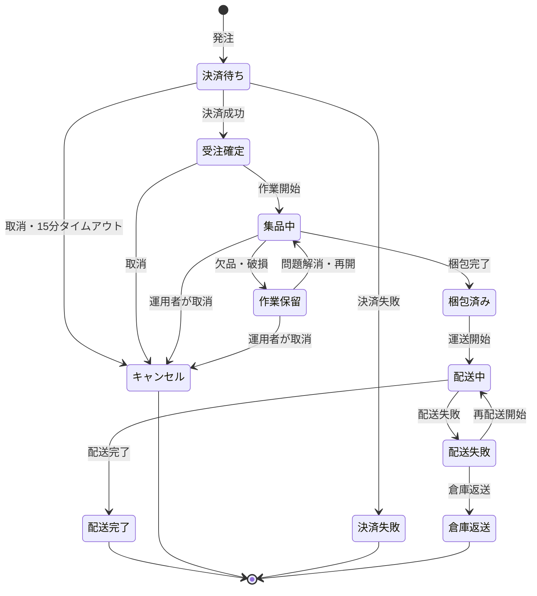
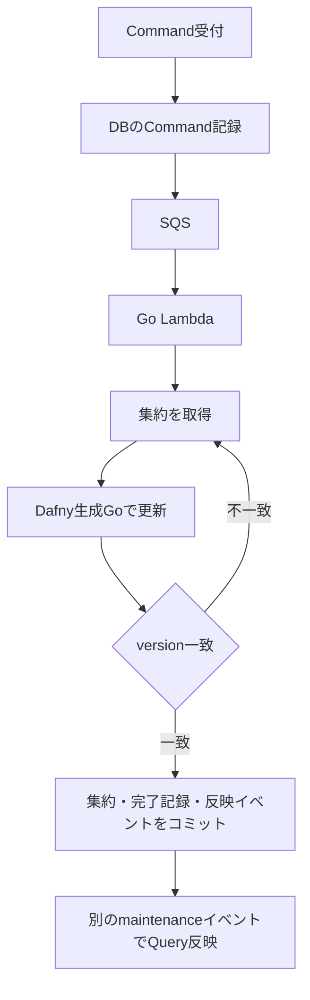

# 受注から配送完了まで

## 通常の流れ

| 担当 | 操作 | 確定後の状態 | 在庫・金額への影響 |
|---|---|---|---|
| 顧客 | 商品をカートへ追加 | お取り置き | 販売可能数が減る。変更から1時間 |
| 顧客 | 配送先を指定して発注 | 決済待ち | 引当を受注へ移管。価格・税・割引を固定 |
| 顧客 | 擬似決済成功 | 受注確定 | 引当を維持 |
| 倉庫作業者 | 作業開始 | 集品中 | 担当者を確定。別担当者の二重着手を拒否 |
| 倉庫作業者 | 箱数・重量を入力し梱包完了 | 梱包済み | UUID付きの箱を作成 |
| 運送業者 | 追跡番号を入力し運送開始 | 配送中 | 手持ち数と引当数を出荷数量分減らす |
| 運送業者 | 配送完了 | 配送完了 | ポイント付与、請求書作成、メール送信待ち登録 |
| システム | SMTP送信 | 配送完了のまま | MailpitにPDF添付メールが届く |

## 状態遷移

梱包後の取消は今回は禁止。配送完了・取消・決済失敗・倉庫返送は終端状態。同じCommandの再配信は成功結果を再利用し、新しいCommand IDで終端処理を繰り返した場合は拒否する。

## 異常系

| 異常 | 処理 | 回復 |
|---|---|---|
| カート追加時の在庫不足 | Commandを拒否し、全SKUの変更をロールバック | 数量を減らす |
| カートの期限切れ | 発注不可。引当は定期処理で解放 | 商品を追加し直す |
| 古い期限切れイベント到着 | 現在の期限と異なるため無処理 | 不要 |
| 決済失敗 | 決済失敗で終了し、引当を解放 | カートから新たに発注 |
| 決済待ち15分 | 定期処理でキャンセル | 新たに発注 |
| 集品時の欠品・破損 | 担当者が作業保留にして理由を記録 | 代替品確保後に再開、または運用者が取消 |
| 引当数より少ない棚卸値 | 在庫調整を拒否 | 先に対象受注を取消し、引当を解放して調整 |
| 出荷と取消の競合 | versionが先に更新された操作のみ成立 | 最新状態で再判断。梱包済み以降は取消禁止 |
| 配送先不在・住所不明 | 配送失敗にして理由を記録 | 再配送または倉庫返送 |
| 返送 | 受注を終端にする。自動で在庫を戻さない | オペレーターが検品後に在庫調整 |
| SQSの重複配信 | 完了済みCommandを読み、業務更新をしない | 不要 |
| DBコミット後・SQS削除前の停止 | 同じCommandが再配信される | DBの完了記録により無処理 |
| SQSに送れない | DBに受付済みCommandが残る | maintenanceが再送 |
| 一時的なDB障害 | SQSの可視性タイムアウト後に再実行 | 障害解消後に再開 |
| 繰返し処理エラー | DBでdead。SQSにもDLQを設定 | 運用画面の処理履歴から再投入 |
| SMTP障害 | 請求書は保持。送信ジョブを再試行 | Mailpit復旧後のmaintenance |
| SMTP受付直後の停止 | 同じMessage-IDのメールが再送され得る | メールだけはexactly-once保証の対象外 |

## 画面の読み方

「受付済み」はDBへのCommand登録完了。「完了」で業務操作が確定する。読み取り画面の更新は少し遅れる場合がある。詳細の状態履歴には日時、担当者、理由を残す。入力の拒否は処理履歴で確認できる。

## カート期限を短時間で試す

通常は1時間。検証専用SQLで対象カートの期限だけを過去にして、maintenanceを投入する。`scripts/expire-cart.sql` を参照。通常操作として時間を短くする機能は設けていない。時刻境界はDafnyとGoのテストで待機せず検証する。

## 検証済みコードと永続化

形式証明は在庫・引当、カートの期限、明細小計・割引・税・ポイント、受注遷移と履歴の核が対象。配送状態に必要な担当者・箱・追跡番号もDafnyで判定する。ロール検査、SQL、AWS SDK、PDF、SMTP、UIはテスト対象。Dafnyの証明をアプリ全体の証明と呼ばない。
